  

  
  
  
  

**AI/ML Developer · LLM Engineering · Agentic Systems**

*Designing, building and evaluating AI-powered software.*

---

## About

I’m a technical student focused on **AI/ML and full-stack engineering**. I work across LLM-powered applications, agentic workflows, retrieval systems, model adaptation and the backend services that connect them.

I enjoy taking an idea beyond a notebook: understanding the system, building the components, exposing them through usable interfaces, and testing how they behave.

## Engineering focus

| Area | What I work on |
|:--|:--|
| **Agentic systems** | Tool orchestration, multi-agent workflows, task planning and automation |
| **LLM engineering** | Model integration, prompt design, LoRA/QLoRA workflows and evaluation |
| **Retrieval & memory** | Hybrid dense/sparse search, vector retrieval, reranking and graph-based memory |
| **AI product engineering** | FastAPI services, React applications, asynchronous processing and deployment |

## Technology stack

**Languages**

**LLMs & agent frameworks**

**Retrieval & machine learning**

**Backend & frontend**

**Data & infrastructure**

## Selected work

<table>
  <tr>
    <td width="50%" valign="top">
      <h3><a href="https://github.com/yash936936/AGM">AGM — Adaptive Graph Memory</a></h3>
      
<strong>Research prototype · v0.7.0 · local-only</strong>

      
A model-agnostic memory layer for AI agents. It combines an event-sourced SQLite core with graph, keyword and vector retrieval, provenance, trust tiers and memory lifecycle controls.

      

        
        
        
        
      

      
Explores memory correctness, retrieval, provenance and lifecycle management. Not production-ready.

    </td>
    <td width="50%" valign="top">
      <h3><a href="https://github.com/yash936936/AI-System-Design">SysDesign AI</a></h3>
      
<strong>RAG-grounded system design</strong>

      
An AI system-design tool that distinguishes HLD and LLD requests, gathers requirements, and generates architecture artifacts such as diagrams, capacity estimates, data models and API schemas.

      

        
        
        
        
      

    </td>
  </tr>
  <tr>
    <td width="50%" valign="top">
      <h3><a href="https://github.com/yash936936/AI-Powered_Document_Analysis_And_Extraction">Document Intelligence API</a></h3>
      
<strong>Asynchronous document processing</strong>

      
A REST API that accepts PDF, DOCX and image files, extracts their content through format-specific processors, and returns structured summaries, named entities and sentiment analysis.

      

        
        
        
        
      

    </td>
    <td width="50%" valign="top">
      <h3><a href="https://github.com/yash936936/LoRA">LoRA Fine-Tuning Pipeline</a></h3>
      
<strong>Config-driven model adaptation</strong>

      
A pipeline for fine-tuning Hugging Face causal language models with LoRA and QLoRA, evaluating checkpoints, merging adapters and serving models for inference.

      

        
        
        
        
      

    </td>
  </tr>
</table>

**Also worth exploring:** [CLI Web Researcher](https://github.com/yash936936/CLI-web-researcher) — a command-line workflow that searches the web, synthesizes sources and produces citation-backed Markdown reports.

## Engineering map

This map separates projects documented in my repositories from the areas I am actively exploring, the technologies I work with, and the research questions I want to understand better.

```mermaid
flowchart TB
    ME(("YASH MALIK<br/>AI/ML · LLM ENGINEERING"))

    ME --> BUILT["BUILT / DOCUMENTED"]
    ME --> BUILDING["BUILDING / EXPLORING"]
    ME --> TOOLKIT["TECHNICAL TOOLKIT"]
    ME --> INTERESTS["RESEARCH INTERESTS"]

    BUILT --> AGM["AGM<br/>Agent memory · graph retrieval<br/>Research prototype"]
    BUILT --> SYS["SysDesign AI<br/>HLD/LLD · RAG-grounded design"]
    BUILT --> DOC["Document Intelligence API<br/>OCR · async processing · LLM analysis"]
    BUILT --> LORA["LoRA Pipeline<br/>LoRA / QLoRA fine-tuning"]
    BUILT --> CLI["CLI Web Researcher<br/>Citation-backed research reports"]

    BUILDING --> AGENT["Agent workflows<br/>Tool use · orchestration"]
    BUILDING --> RETRIEVAL["Retrieval systems<br/>RAG quality · reranking"]
    BUILDING --> MEMORY["Agent memory<br/>Context · provenance · reliability"]
    BUILDING --> PRODUCTS["Deployable AI products<br/>Models · APIs · interfaces"]

    TOOLKIT --> LANG["Languages<br/>Python · C++ · JavaScript · TypeScript · SQL"]
    TOOLKIT --> AI["LLM tooling<br/>LangChain · LangGraph · Hugging Face"]
    TOOLKIT --> WEB["Application stack<br/>FastAPI · Node.js · React · Next.js"]
    TOOLKIT --> DATA["Data & retrieval<br/>SQLite · PostgreSQL · MongoDB · Redis · ChromaDB"]
    TOOLKIT --> ML["ML & data tools<br/>scikit-learn · NumPy · Pandas"]

    INTERESTS --> NLP["LLMs & NLP"]
    INTERESTS --> RAG["RAG · information retrieval · search"]
    INTERESTS --> ADAPT["Model adaptation · efficient fine-tuning"]
    INTERESTS --> MULTI["Multi-agent systems · autonomous workflows"]
    INTERESTS --> TRUST["Trustworthy AI · evaluation · memory"]

    AGM -.-> MEMORY
    SYS -.-> RAG
    DOC -.-> NLP
    LORA -.-> ADAPT
    CLI -.-> RETRIEVAL

    classDef identity fill:#102832,stroke:#43d7c5,color:#f2fffd,stroke-width:2px
    classDef group fill:#1b1a31,stroke:#a79bff,color:#ffffff,stroke-width:1.5px
    classDef project fill:#10252e,stroke:#43d7c5,color:#eafffc
    classDef detail fill:#171f2d,stroke:#71869f,color:#edf3fb

    class ME identity
    class BUILT,BUILDING,TOOLKIT,INTERESTS group
    class AGM,SYS,DOC,LORA,CLI project
    class AGENT,RETRIEVAL,MEMORY,PRODUCTS,LANG,AI,WEB,DATA,ML,NLP,RAG,ADAPT,MULTI,TRUST detail
```

## 🤝 Connect & Collaborate

I’m interested in connecting with developers and researchers working on **LLMs, NLP, retrieval systems, agentic AI and practical AI engineering**.

For technical discussions, project collaboration or research conversations, reach out through [LinkedIn](https://www.linkedin.com/in/yashmalik-/) or [email](mailto:yashsunilmalik@gmail.com).

  Build deliberately. Evaluate honestly. Ship useful systems.

