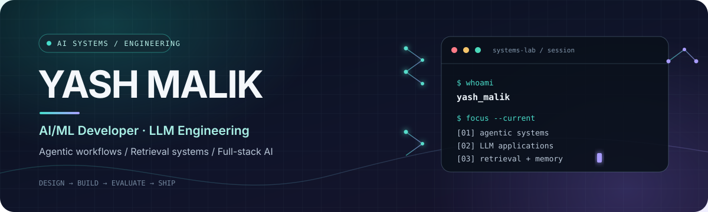
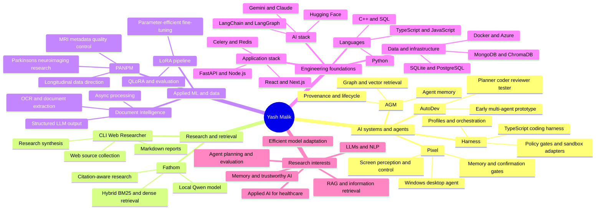

  

  
  
  
  

**AI/ML Developer · LLM Engineering · Agentic Systems**

*Designing, building and evaluating AI-powered software.*

---

## About

I’m a technical student focused on **AI/ML and full-stack engineering**. I work across LLM-powered applications, agentic workflows, retrieval systems, model adaptation and the backend services that connect them.

I enjoy taking an idea beyond a notebook: understanding the system, building the components, exposing them through usable interfaces, and testing how they behave.

## Engineering focus

| Area | What I work on |
|:--|:--|
| **Agentic systems** | Tool orchestration, multi-agent workflows, task planning and automation |
| **LLM engineering** | Model integration, prompt design, LoRA/QLoRA workflows and evaluation |
| **Retrieval & memory** | Hybrid dense/sparse search, vector retrieval, reranking and graph-based memory |
| **AI product engineering** | FastAPI services, React applications, asynchronous processing and deployment |

## Technology stack

**Languages**

**LLMs & agent frameworks**

**Retrieval & machine learning**

**Backend & frontend**

**Data & infrastructure**

## Featured systems

<table>
  <tr>
    <td width="50%" valign="top">
      <h3><a href="https://github.com/yash936936/Harness">Harness — Multi-Agent Coding System</a></h3>
      
<strong>Active research prototype · TypeScript</strong>

      
A coding harness built around agent profiles, model and tool access, retrieval, memory, orchestration, policy gates and sandbox providers. Recent work adds shared SQLite-backed reservations and bounded execution-output handling.

      
Current limits: workspace transfer, result synchronization and live Vercel acceptance remain incomplete. The command tool is disabled.

      

        
        
        
        
      

    </td>
    <td width="50%" valign="top">
      <h3><a href="https://github.com/yash936936/PixelAgent/blob/main/docs/README.md">Pixel — Autonomous Desktop Agent</a></h3>
      
<strong>Windows desktop agent · CLI + GUI</strong>

      
Turns plain-English tasks into desktop actions by reading the screen, navigating applications, clicking and typing. Uses structured automation where available, with a confirmation gate for irreversible or externally visible actions.

      
Core phases through legal and trust are documented as complete; real-user beta and some real-browser stress validation remain open.

      

        
        
        
        
      

    </td>
  </tr>
  <tr>
    <td width="50%" valign="top">
      <h3><a href="https://github.com/yash936936/Fathom/blob/main/docs/readme.md">Fathom — Local-Model Research Assistant</a></h3>
      
<strong>Windows v1 scope closed</strong>

      
A focused research CLI using a local Qwen3 4B model, hybrid BM25 and dense retrieval, LangGraph-based research flow and source-linked answers with citation checks.

      
Designed for research questions, with live web retrieval for freshness. Citation checking has known limits; later platform support is a separate track.

      

        
        
        
        
      

    </td>
    <td width="50%" valign="top">
      <h3><a href="https://github.com/yash936936/AGM">AGM — Adaptive Graph Memory</a></h3>
      
<strong>Research prototype · v0.7.0 · local-only</strong>

      
A model-agnostic memory layer for AI agents. It combines an event-sourced SQLite core with graph, keyword and vector retrieval, provenance, trust tiers and memory lifecycle controls.

      
Explores memory correctness, retrieval, provenance and lifecycle management. Not production-ready.

      

        
        
        
        
      

    </td>
  </tr>
</table>

## More projects and research tracks

| Project | Area | What it explores | Current boundary |
|:--|:--|:--|:--|
| [PANPM](https://github.com/yash936936/PANPM) | Neuroimaging research | Parkinson's progression research using MRI metadata/QC, longitudinal assessments and future model development | Phase 1 metadata-QC work; local BOLD QC, visual review and model training are not complete |
| [LoRA Fine-Tuning Pipeline](https://github.com/yash936936/LoRA) | Model adaptation | Config-driven LoRA/QLoRA training, evaluation, adapter merging and inference | Pipeline repository; results depend on the selected model, data and run |
| [Document Intelligence API](https://github.com/yash936936/AI-Powered_Document_Analysis_And_Extraction) | Applied LLM systems | PDF/DOCX/image extraction, asynchronous processing and structured summary/entity/sentiment output | API project; no production-scale claim |
| [CLI Web Researcher](https://github.com/yash936936/CLI-web-researcher) | Research automation | Search, source extraction, synthesis and citation-backed Markdown reports | CLI tool with mocked offline tests documented in its README |
| [AutoDev](https://github.com/yash936936/AutoDev) | Agentic coding | Planner → coder → reviewer → tester pipeline with a separate oversight layer | Early prototype; latest status note records LLM backend verification still pending |

## The Big Picture

A map of the systems I build, the engineering foundations behind them, and the research questions I want to work on. Project maturity is called out separately below so prototypes and completed work are not presented as the same thing.

## Project status and maturity

| Track | Status from repository documentation | What that means |
|:--|:--|:--|
| **Harness** | Active research prototype; state updated 16 Nov 2026 | Core harness and several reliability changes are implemented. Workspace transfer, result sync and live Vercel acceptance remain open. |
| **Pixel** | Phases 1–17 marked complete, 16 Aug 2026 | CLI/GUI and Windows installer work are documented. Real-user beta has not started; some real-browser validation remains open. |
| **Fathom** | v1 scope closed in its status log | Windows research assistant with local inference and live retrieval. macOS/Linux and later retrieval work are separate follow-up tracks. |
| **PANPM** | Phase 1; latest status 15 Nov 2026 | Acquisition-metadata QC is implemented and CI-validated. Local BOLD QC, montage review and model training remain incomplete. |
| **AGM** | Research prototype v0.7.0 | Local-only memory layer. Real-history evaluation, independent security review and third-party host integration remain open. |
| **AutoDev** | Early prototype; latest status note 20 Aug 2026 | Four-agent skeleton and oversight flow are documented. Gemini backend verification remains pending in that status record. |

## 🤝 Connect & Collaborate

I’m interested in connecting with developers and researchers working on **LLMs, NLP, retrieval systems, agentic AI and practical AI engineering**.

For technical discussions, project collaboration or research conversations, reach out through [LinkedIn](https://www.linkedin.com/in/yashmalik-/) or [email](mailto:yashsunilmalik@gmail.com).

  Build deliberately. Evaluate honestly. Ship useful systems.

